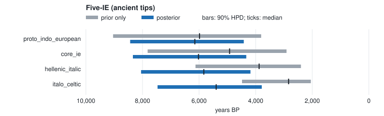

# Indo-European tip-dating (reproduction-style, T1)

Dates a fixed 5-language Indo-European topology from **real IE-CoR cognate data**
(170 meanings) using five *attested ancient* languages whose fixed tip ages
anchor the chronology and, jointly with the cognate data, inform the clock rate
(tip-dating). Reproduction-*style*: it illustrates the method on real data, not a
re-run of any specific published analysis.

```
./run.sh          # ~40 s
```

## Inputs

- `data/` — IE-CoR subset: Vedic (early), Ancient Greek, Latin, Old Irish, Old
  Church Slavonic. CC-BY-4.0; see `../DATA_SOURCE.md`.
- `tree.nwk` — an **illustrative** fixed topology (one hypothesis of the
  inter-branch structure). v1 does not infer topology.
- `calibrations.tsv` — fixed tip ages from the languages' approximate attestation
  (Vedic 3200, Greek 2400, Latin 2050, Old Irish 1250, OCS 1050 BP; illustrative),
  and a broad uniform prior on the PIE root.

## Representative output (seed 42, default: relaxed clock, 4 chains × 4,000 + 4,000)

| node | median BP | 90% HPD | lexical age (90% HPD) | R̂ | ESS |
|---|---|---|---|---|---|
| proto_indo_european | ~6580 | 4187–9432 | 1.74 (1.19–2.42) | 1.00 | 1354 |
| core_ie | ~6270 | 3969–9010 | 1.67 (1.13–2.30) | 1.00 | 1358 |
| hellenic_italic | ~5870 | 3767–8419 | 1.56 (1.04–2.18) | 1.00 | 1379 |
| italo_celtic | ~5260 | 3357–7546 | 1.40 (0.89–1.99) | 1.00 | 1487 |

The PIE-root posterior is **wide and rate-prior-sensitive**. Its median sits
between the Steppe (~5500–6000 BP) and Anatolian (~8000–9500 BP) ranges, and
its 90% HPD covers both, so five ancient tips cannot decide between them. That
is the honest scientific situation for deep-time lexical dating, and the point
of the example: the tool reports the uncertainty and the diagnostics rather
than a false point date. Changing `--rate-logmean/-logsd` shifts the root age
materially, which the run manifest documents. The strict clock (`--relaxed 0`)
gives a median of ~6150 BP with a narrower 4421–8436 BP.

Since the proper age prior and the joint moves of `docs/inference.md`, this
deep tree mixes well under either clock: every node has ESS above 1,300.

## Prior only against posterior



The grey bar is the node's age with the cognate likelihood switched off (the same run's `prior_*` columns: tree prior, calibrations and clock prior only). The blue bar is the posterior. `prior_overlap` in `posterior_nodes.tsv` measures how much the two share.

**The root is mostly prior.** Its overlap is 0.85: the posterior, 4,187–9,432 BP,
is nearly the prior's 3,820–9,095 BP. The width of the root is therefore the
width of the clock and root priors, not a finding from the cognates. The data
do act on the inner nodes, which they push much older than the prior's uniform
ratios put them (Italo-Celtic 2,837 → 5,257 BP, overlap 0.29): the ancient tips
are lexically far apart, so their common ancestors must be old.

Regenerate after `./run.sh` with
`python3 ../../tools/plotting/overlay.py output/posterior_nodes.tsv --svg prior_overlay.svg --title "Five-IE (ancient tips)"`, which also prints the numbers as a table.
