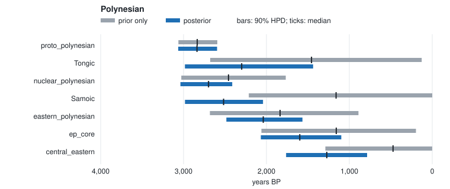

# Polynesian chronology (a shallow, cleanly-dated family, T1)

Dates a fixed Polynesian topology from **real cognate data** — Walworth (2018) —
for eight doculects across the main Polynesian branches (Tongic, Samoic, Eastern
Polynesian). Polynesian is a *shallow, well-dated* family, so unlike the deep
Indo-European and Sino-Tibetan roots this one converges crisply and its ages are
archaeologically defensible — the clean-case counterpoint in the example set.

```
./run.sh          # ~2 min; writes output/posterior_nodes.tsv, diagnostics.tsv, run_manifest.tsv
```

## Inputs

- `data/` — a LexiCore subset from `lexibank/walworthpolynesian` (CC-BY-4.0; see
  `../DATA_SOURCE.md`), via `tools/datasets/lexibank.py`.
- `tree.nwk` — an **illustrative** fixed topology following the accepted
  Polynesian subgrouping (Tongic vs Nuclear; Samoic and Eastern Polynesian
  within Nuclear; Rapanui basal in Eastern).
- `calibrations.tsv` — the Proto-Polynesian root is anchored by a **node
  calibration** (uniform 2600–3100 BP, the archaeological settlement window),
  rather than by tip-dating a reconstruction; extant tips are at 0. This is the
  clean way to date a shallow family whose members are all modern.

## Representative output (seed 42, default: relaxed clock, 4 chains × 4,000 + 4,000)

| node | median BP | 90% HPD | R̂ | ESS |
|---|---|---|---|---|
| proto_polynesian (root) | ~2838 | 2596–3065 | 1.00 | 6181 |
| nuclear_polynesian | ~2699 | 2413–3038 | 1.00 | 3063 |
| Samoic | ~2517 | 2042–2983 | 1.005 | 1778 |
| Tongic | ~2299 | 1437–2983 | 1.00 | 2014 |
| eastern_polynesian | ~2038 | 1566–2484 | 1.00 | 1867 |
| central_eastern (Māori–Tahitian–Hawaiian core) | ~1272 | 786–1763 | 1.00 | 1211 |

Every node converges (R̂ ≤ 1.005, ESS above 1,200). The ages line up with the
linguistic/archaeological picture: a Proto-Polynesian break-up ~2800 BP, an
Eastern-Polynesian node around 2000 BP, and the Central-Eastern core more
recent. Absolute ages still rest on the root calibration and rate prior, as
`run_manifest.tsv` records — see `docs/scientific-methods.md`.

**The clock matters here.** Under the strict clock (`--relaxed 0`, which needs
10,000 + 10,000 to converge on this tree) the Central-Eastern core is ~1,742 BP
(1,448–2,042), a quarter older, and Tongic ~1,919 BP. The relaxed clock predicts
held-out concepts much better on this family (by 26–30 in elpd, about 4 SE;
`docs/research/model-uncertainty.md`). The run flags `branch_rate_confounded`:
with one calibrated node and all tips modern, a fast branch and a long branch
look alike, so the internal ages carry that trade-off in their width. Do not
read the individual branch rates.

## Prior only against posterior



The grey bar is the node's age with the cognate likelihood switched off (the same run's `prior_*` columns: tree prior, calibrations and clock prior only). The blue bar is the posterior. `prior_overlap` in `posterior_nodes.tsv` measures how much the two share.

The root is the calibration. Its overlap is 0.96, so the 2,600–3,100 BP
window passes through unchanged, as it should for a node-calibrated family. Every
internal node is set by the data. Without them the uniform-ratio prior would put
the Central-Eastern core at 473 BP (0–1,289); the cognates put it at 1,272 BP
(overlap 0.33). The internal chronology is a result; the root is an input.

Regenerate after `./run.sh` with
`python3 ../../tools/plotting/overlay.py output/posterior_nodes.tsv --svg prior_overlay.svg --title "Polynesian"`, which also prints the numbers as a table.

Contrast with `examples/sinotibetan_tree` and `examples/five_ie_reproduction`,
where the deep root is only weakly identified: the difference is time depth and
calibration, not the tool.
