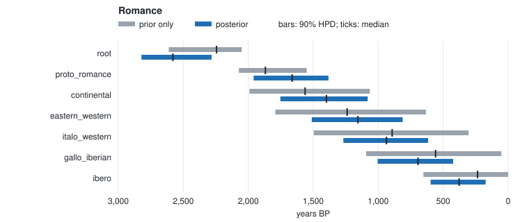

# Romance chronology (fixed tree, T1)

Dates the internal nodes of a fixed Romance topology from **real IE-CoR cognate
data** (8 doculects, 170 meanings) under the strict novel-state model (T1), with
Classical Latin as an attested tip anchoring the absolute scale.

```
./run.sh          # ~1.5 min; writes output/posterior_nodes.tsv, diagnostics.tsv, run_manifest.tsv
```

## Inputs

- `data/` — IE-CoR subset (Latin, Italian, Spanish, Portuguese, French, Romanian,
  Catalan, Sardinian). See `../DATA_SOURCE.md` for licence/attribution and how to
  regenerate. CC-BY-4.0 (Heggarty, Anderson & Scarborough, IE-CoR v1.0).
- `tree.nwk` — an **illustrative** fixed Romance topology (Sardinian basal,
  Eastern/Western split, Gallo-Ibero grouping). Not a phylogenetic claim.
- `calibrations.tsv` — Latin fixed at 2050 BP (illustrative Classical-Latin
  attestation), extant tips at 0, broad uniform priors on the root and
  proto-Romance node. Illustrative anchors, not authoritative dates.

## Representative output (seed 42, default: relaxed clock, 4 chains × 4,000 + 4,000)

| node | median BP | 90% HPD | R̂ | ESS |
|---|---|---|---|---|
| root (Latin era) | ~2580 | 2282–2822 | 1.00 | 3402 |
| proto_romance | ~1662 | 1383–1959 | 1.00 | 2928 |
| continental | ~1398 | 1081–1753 | 1.00 | 2443 |
| gallo_iberian | ~694 | 423–1004 | 1.00 | 1892 |
| ibero (Spanish–Portuguese) | ~377 | 173–596 | 1.00 | 2392 |

Proto-Romance lands near ~1650 BP (Late Latin dispersal). Every node reports a
posterior **distribution** with a credible interval and convergence diagnostics
(R̂, ESS) — never a point date. Absolute ages depend on the rate prior and the
calibrations, as `run_manifest.tsv` records. Under the strict clock
(`--relaxed 0`) Proto-Romance comes out at ~1530 BP with a narrower interval
(1377–1761); the relaxed clock predicts held-out concepts better on this family
(`docs/research/model-uncertainty.md`).

## Prior only against posterior



The grey bar is the node's age with the cognate likelihood switched off (the same run's `prior_*` columns: tree prior, calibrations and clock prior only). The blue bar is the posterior. `prior_overlap` in `posterior_nodes.tsv` measures how much the two share.

The data move every node, though less than under a strict clock: overlaps are
0.49–0.70. They push the root older than its prior (median 2,244 → 2,580 BP)
and Proto-Romance younger (1,868 → 1,662). Below Proto-Romance the prior is
nearly flat across the allowed range; the cognates cut each interval to
55–65% of its width. The per-branch rates absorb part of what the strict clock
attributes to time.

Regenerate after `./run.sh` with
`python3 ../../tools/plotting/overlay.py output/posterior_nodes.tsv --svg prior_overlay.svg --title "Romance"`, which also prints the numbers as a table.

Try `--relaxed 0` for the strict clock, and compare the branch-rate/date
confounding diagnostic in `run_manifest.tsv` (`branch_rate_confounded` is 0
here: Latin's date separates rate from time).
