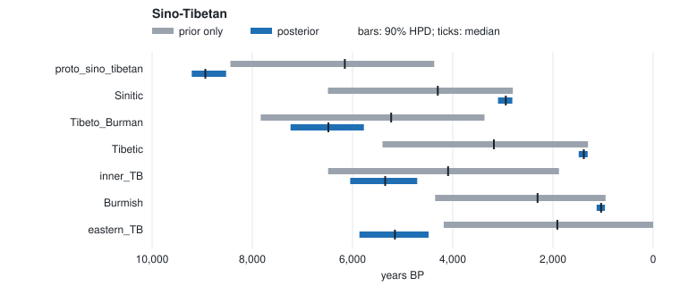

# Sino-Tibetan chronology (a different family, T1)

Dates a fixed Sino-Tibetan topology from **real cognate data** — Sagart et al.
(2019), the Sino-Tibetan Database of Lexical Cognates behind the PNAS dated
phylogeny — using eight doculects across five subgroups (Sinitic, Tibetic,
Burmish, Kiranti, rGyalrong), with **Old Chinese, Old Tibetan and Old Burmese**
as attested tip anchors. This complements the Indo-European examples with a
second, unrelated family, driven by the same converter and CLI.

```
./run.sh          # ~10 min; writes output/posterior_nodes.tsv, diagnostics.tsv, run_manifest.tsv
```

## Inputs

- `data/` — a LexiCore subset from `lexibank/sagartst` (CC-BY-4.0; see
  `../DATA_SOURCE.md`). Generated with the family-agnostic converter
  `tools/datasets/lexibank.py`.
- `tree.nwk` — an **illustrative** fixed topology grouping the doculects by
  subgroup. Not a phylogenetic claim; Sagart et al. infer the topology.
- `calibrations.tsv` — attested tip ages (Old Chinese 2800, Old Tibetan 1300,
  Old Burmese 950 BP; illustrative), extant tips at 0, and a broad uniform prior
  on the Proto-Sino-Tibetan root.

## Representative output (seed 42, relaxed clock, 4 chains × 10,000 + 10,000)

This tree needs longer chains than the 4,000 + 4,000 default: at the default
the deep nodes reach R̂ 1.018.

| node | median BP | 90% HPD | R̂ | ESS |
|---|---|---|---|---|
| Sinitic (Old Chinese + Mandarin) | ~3091 | 2810–3554 | 1.00 | 4991 |
| Tibetic (Old Tibetan + Lhasa) | ~1476 | 1308–1774 | 1.00 | 4876 |
| Burmish (Old Burmese + Rangoon) | ~1150 | 964–1430 | 1.00 | 4426 |
| Tibeto-Burman core | ~6642 | 4878–8423 | 1.00 | 689 |
| proto_sino_tibetan (root) | ~8248 | 6808–9173 | 1.00 | 1481 |

The **subgroup ages are well estimated** and archaeologically sensible (Sinitic
diversification ~3100 BP; Tibetic ~1500 BP). The **root is deep and wide**:
under the relaxed clock its median sits inside the soft 4500–9000 BP window,
and its 90% HPD just reaches past the top. Under the strict clock
(`--relaxed 0`) the rate pinned by the recent tip anchors put the root at
~8940 BP (8524–9209), pressing on the window's upper bound: the per-branch
rates of the relaxed clock relieve that tension. Sagart et al.'s ~7200 BP comes
from a relaxed clock with node calibrations and an inferred topology; adding
internal node calibrations is the route to a comparable estimate here. Treat
the root as "deep and weakly identified", and see
`docs/scientific-methods.md`.

## Prior only against posterior



The grey bar is the node's age with the cognate likelihood switched off (the same run's `prior_*` columns: tree prior, calibrations and clock prior only). The blue bar is the posterior. `prior_overlap` in `posterior_nodes.tsv` measures how much the two share.

The data dominate the subgroups with an attested tip (overlaps 0.21–0.34): each
collapses onto a narrow interval just above that tip. Eastern Tibeto-Burman is
pushed much older than the prior puts it (1,908 → 4,914 BP, overlap 0.28); the
Tibeto-Burman and inner nodes move less (0.61–0.62). The root is pushed from the prior's 6,229 BP to 8,248 BP,
toward the top of its window: the cognates, read through the attested tips,
favour a deeper root than the window's centre.

Regenerate after `./run.sh` with
`python3 ../../tools/plotting/overlay.py output/posterior_nodes.tsv --svg prior_overlay.svg --title "Sino-Tibetan"`, which also prints the numbers as a table.
